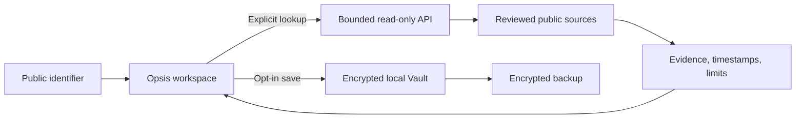

<p align="center">
  
</p>

<p align="center"><a href="docs/assets/opsis-banner.gif?raw=true&amp;v=3">Play animated banner</a> · <a href="docs/assets/opsis-banner.png">View still image</a></p>

<p align="center">
  <a href="LICENSE"></a>
  
  
  
</p>

<p align="center">
  <a href="#four-ways-to-look-closer">Explore the tools</a> ·
  <a href="#run-locally">Run locally</a> ·
  <a href="docs/public-source.md">Source & identity policy</a> ·
  <a href="LICENSE">License</a>
</p>

# See what the chart misses.

**Opsis is a research and trading-intelligence hub for Robinhood Chain.**
Paste a token, wallet, or transaction. Inspect the evidence behind it, explore
what an exit at your size looks like, revisit saved observations, and run
reproducible experiments on your own data.

Research without connecting a wallet or signing up. Public lookups carry their
sources and coverage limits. Your saved notes, purchase lots, watchlists, and
imported datasets stay in your browser.

> **Source available, for noncommercial use.** This is a filtered public source
> repository, not a deployment feed. Included code does not mean a feature is
> enabled on the hosted product. In-app transaction execution is not available.

## Four ways to look closer

| Area | Tools in the source | What to expect |
| --- | --- | --- |
| **Look up** | Research, Stock-token check, Big trades, World & markets | Source-linked observations about public identifiers. Captured editions remain dated; provider gaps stay visible. |
| **Before you trade** | Trade Check, Perp cost scenario, Portfolio shocks | Size-specific exit observations where supported, plus local hypothetical scenarios with explicit inputs and assumptions. |
| **Keep watch** | Watch, Saved | Encrypted local observations and comparisons when you refresh. No promise of monitoring while your browser is closed. |
| **Explore data** | Quant Lab | Local dataset validation, realized-risk calculations and seeded bootstrap experiments. Simulated outcomes are not predictions. |

Supported checks are bounded by chain, pool, source, quota, and feature flags.
Missing evidence is **unknown**, not zero. A verified contract is not a safety
verdict, and a quote preview is not an executable guarantee.

Opsis does not hold private keys, sign, broadcast, or submit transactions.
Official external tools own execution and independently requote. Network,
liquidity, and protocol costs can apply there. Perp scenarios use your inputs;
the venue's own liquidation figure and eligibility rules govern any actual trade.

## Public evidence. Private context.



Public providers can observe the identifiers you ask them to read. Local privacy
is not network anonymity. Vault notes, lots, photos, and imported datasets are
not inputs to those public lookups or model explanations.

The Vault uses browser Web Crypto: **AES-256-GCM**, fresh random IVs, and a master
key wrapped with a **PBKDF2-HMAC-SHA-256** passphrase key using 600,000 iterations
and a random salt. Encrypted records and wrapped keys live in IndexedDB.
Recovery and encrypted backup/restore are included.

**Export backups regularly.** Browser data can be cleared or evicted; a different
site origin or browser profile has different storage. Keep the matching
passphrase or recovery material separately. Encryption does not protect an
unlocked page from a compromised device, browser extension, or malicious script.

## Run locally

Use **Node.js 22.12–22.x** and **pnpm 8.15.9**. The lockfile is included.

```bash
pnpm install --frozen-lockfile
cp .env.example .env
pnpm --filter @rh-chain/shared --filter @rh-chain/quant build
pnpm --filter @rh-chain/api db:generate
```

For the minimal deterministic development path, set these values in your local
`.env` (the checked-in example otherwise selects Ollama):

```dotenv
AI_PROVIDER=fallback
ENABLE_PUBLIC_RPC_FALLBACK=true
CLOUD_WORKSPACE_ENABLED=false
VITE_CLOUD_WORKSPACE_ENABLED=false
```

```bash
pnpm dev
```

Open the workspace at **http://localhost:5173/app**. The API listens on
**http://localhost:4000**; local API docs are at `/docs` and readiness at `/readyz`.
This setup does not configure production providers or enable every specialist
tool. See [.env.example](.env.example) and
[environment validation](apps/api/src/config/env.ts) for configuration and limits.
Keep unused integrations disabled. Never put a provider secret in a `VITE_*`
variable or commit `.env`.

## Inside the repository

```text
apps/web/          React workspace, local Vault, charts and tools
apps/api/          Fastify routes, evidence, providers and request budgets
packages/shared/   Shared contracts and validation
packages/quant/    Local statistics and reproducible experiments
e2e/               Browser workflows, privacy and failure-state tests
scripts/           Verification, identity guards and source export
.githooks/         Commit identity and approved-destination checks
docs/              Reviewed public documentation and banner assets
```

**TypeScript · React · Vite · Fastify · Zod · viem · ECharts · Web Crypto**

PostgreSQL, Redis, and provider integrations are used where configured. Minimal
in-memory development is not a production persistence recommendation.

```bash
pnpm lint
pnpm typecheck
pnpm test
pnpm build
pnpm exec playwright install chrome webkit
pnpm test:e2e
```

Browser regressions use deterministic provider fixtures. Live-provider and
database integration checks have separate requirements. Passing tests is not an
independent security audit. The animated banner is reproducible with
`node scripts/render-readme-banner.mjs` (Chrome and ffmpeg required); a
[still version](docs/assets/opsis-banner.png) is included.

## Publication and identity guards

Development happens in a separate private repository. The reviewed export keeps
application source, tests, and build inputs, while excluding internal operations,
secrets, original identity metadata, and deployment automation.

Every public commit uses **`Opsis <source@opsis.invalid>`** for both author and
committer. Attribution trailers are removed during export. The reserved address
is a publication identity, not a contact mailbox or a claim of sole authorship.
GitHub may still display the account performing a push in its activity records.

History is explicitly a **filtered reconstruction**. Original development dates
and parent relationships are preserved; they are not publication dates. Changes
that only touched excluded material become labeled checkpoints. No activity is
invented or backdated to manufacture a development record. The private history
is not rewritten, and private branches and tags are never pushed here.

Install the local hooks in each clone using the instructions in
[the public-source policy](docs/public-source.md). They check author and committer
identity, attribution trailers, the approved push destination, and the reviewed
public tree. Hooks reduce accidental disclosure; they cannot promise anonymity.

For a suspected vulnerability, do not publish secrets or exploit details in a
public issue. A support and security contact is to be published on this page.

## Noncommercial license

Project-authored code and documentation are **source-available under
[PolyForm Noncommercial 1.0.0](LICENSE)**. Use, modification, self-hosting, and
redistribution must stay within its permitted purposes and preserve required
notices. Commercial use outside those permissions needs a separate written
license from the applicable rights holders.

This is not a permissive open-source license. The complete license controls;
earlier revisions retain their original terms. Dependencies and bundled assets
retain their own licenses—see [dependency licensing](docs/dependency-licenses.md)
and [third-party notices](apps/web/public/THIRD_PARTY_NOTICES.txt). The project
license grants no rights to third-party data or trademarks and does not transfer
copyright ownership through commit identity normalization.

Opsis is independent. Referenced providers and brands do not imply sponsorship
or endorsement. **Informational software. Not investment advice.**
