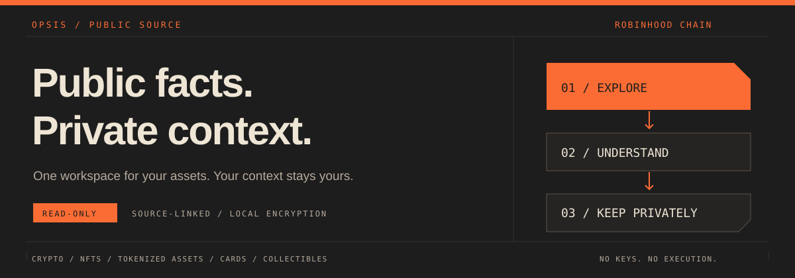
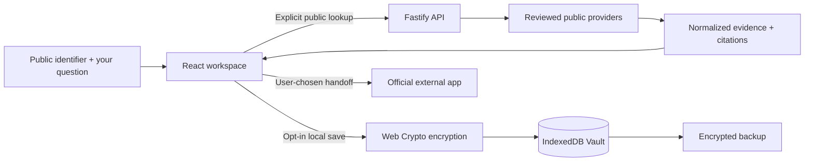

> **Opsis** is a research and trading-intelligence hub built on this repository’s existing engines. The product direction, scope and build order are in [docs/opsis/](docs/opsis/README.md). Opsis is the final name (decision D22).

<p align="center">
  
</p>

<p align="center">
  <a href="LICENSE">License: PolyForm Noncommercial 1.0.0</a>
</p>

```text
  +----------------------------------------------------------------+
  |  OPSIS                                           CHAIN // 4663 |
  |                                                                |
  |  Public chain facts  --->  Clear explanations                  |
  |  Your private context --->  Your encrypted, local Vault        |
  |                                                                |
  |  READ-ONLY BY DESIGN.  NO KEYS.  NO TRADE EXECUTION.           |
  +----------------------------------------------------------------+
```

# Understand what you own. Keep your context private.

Opsis is a read-only asset intelligence workspace for **Robinhood Chain**.
Explore wallets and transactions, inspect tokenized-asset claims, preview supported
swaps, and keep your own crypto, NFT, Pokémon card, collectible, and real-world
asset records together in an encrypted, browser-local Vault.

The distinction is deliberate: **public evidence comes from public sources;
your purchase prices, ownership notes, photos, and saved chats stay local.**

> This repository is a public source mirror, not a deployment feed. Source
> availability does not mean every feature is enabled on the hosted site.
> Its history is a filtered reconstruction: original commit dates, counts and
> merge relationships are retained, while author/committer identities are
> normalized to the project. Private files and deployment automation are omitted.

## What you can do

| Workspace | What it does | Important boundary |
| --- | --- | --- |
| **Research** | Explain a public wallet, token, contract, or transaction with source-linked facts and follow-up questions. | No account or wallet connection required. Provider gaps are reported, not invented away. |
| **Encrypted Vault** | Track assets, exact purchase lots, notes, local photos, and dated values. Export, restore, recover, and lock your records. | Browser-local ciphertext; not automatic cloud sync. Manual ownership and valuations are your claims. |
| **Local chat history** | Opt into encrypted autosave by unlocking the Vault in Explorer. Reopen saved conversations and include them in backups. | Same browser profile and site origin. Saved answers are dated snapshots, not refreshed evidence. |
| **Portfolio Intelligence** | Build a read-only holdings/activity snapshot and combine it with private local context. | Coverage is bounded and provider-dependent. A captured current block is not a finality guarantee. |
| **Stock-token check** | Check exact-address Stock Token and Morpho vault identity, source evidence, and limitations. | A registry match is not proof of physical authenticity, solvency, redemption eligibility, or safety. |
| **Swap preview** | Inspect a supported WETH/USDG preview, freshness, minimum received, costs, and simulation information. | Official Uniswap independently requotes and owns signing/execution. Opsis never submits a trade. |
| **Collectible Catalog** | Match supported Pokémon card identity and attach owner-reported variant, condition, grading, photos, and references. | Catalog metadata and permitted image paths do not authenticate a card or establish its value. Manual entry remains available. |
| **Market & Inventory** | Compare supported public observations and approved merchant mappings with private landed-cost inputs. | Opt-in, flag-controlled. Coverage and freshness vary; unsupported venues use outbound handoffs. |
| **Replay Actions** | Rebuild a supported trade or purchase with fresh inputs and current evidence. | Flag-controlled. It does not infer or reuse historical intent, calldata, approvals, or checkout sessions. |
| **Open Data API** | Reuse a small reviewed support registry and normalize identifier syntax. | Flag-controlled. Not a general price feed, wallet-history API, or API for private Vault data. |

### What this does not do

- Hold private keys, seed phrases, funds, or custody of assets.
- Sign, broadcast, route, or execute transactions; mint or redeem assets.
- Promise complete portfolio coverage, trustworthy issuers, or accurate manual valuations.
- Guarantee that a browser will retain local data forever.
- Enable cloud research or token-paid query packs by default. These are not
  implied launch features or economic rights simply because code is public.

Network gas, liquidity, and protocol costs may apply at an official execution
venue. Read-only does **not** mean third-party actions are free.

## How the pieces fit together



The API validates identifiers, applies request limits and provider budgets,
normalizes the available evidence, and returns citations and limitations.
Supported AI paths can explain those facts; a deterministic fallback remains
available. Public Research uses the privacy-specific route and reports
the actual destinations in its privacy receipt. Optional cloud/AI paths have
different data boundaries and must not be confused with that mode.

Private notes, purchase lots, photos, Vault keys, and passphrases are not inputs
to public-provider lookups. Providers can still observe identifiers you choose
to send them. “Private” does not mean anonymous networking or invisible traffic.

## Inside the encrypted Vault

- **Encryption:** AES-256-GCM via browser Web Crypto, with fresh random IVs.
- **Passphrase wrapping:** PBKDF2-HMAC-SHA-256 with 600,000 iterations and a random
  salt derives a key that wraps the Vault's master key.
- **Recovery:** a separately generated recovery secret wraps the master key;
  recovery rotates the relevant recovery material.
- **Storage:** encrypted records and wrapped keys live in IndexedDB. The unlocked
  key exists in the page's memory and is removed from application state on lock.
- **Backups:** encrypted JSON includes the records and wrapped key material.
  Restore verifies the backup before replacing local data. Keep the matching
  passphrase or recovery code separately and test restoration.

This does not defend against a compromised device, malicious browser extension,
or malicious code executing in the page while the Vault is unlocked. A copied
backup can be attacked offline; use a strong, unique passphrase. Clearing site
data, browser eviction, private browsing, a lost device, or lost recovery material
can permanently lose access. Another browser, subdomain, or port is a different
storage location. **Export backups regularly.**

## Run locally

Prerequisites: **Node.js 22.12–22.x**, **pnpm 8.15.9**, and Git. Version files and
the lockfile are included. No global services or paid subscriptions are needed
for the minimal deterministic development path.

```bash
pnpm install --frozen-lockfile
cp .env.example .env
pnpm --filter @rh-chain/shared build
pnpm --filter @rh-chain/api db:generate
```

In your local `.env`, use the deterministic path to start without a model:

```dotenv
AI_PROVIDER=fallback
ENABLE_PUBLIC_RPC_FALLBACK=true
CLOUD_WORKSPACE_ENABLED=false
VITE_CLOUD_WORKSPACE_ENABLED=false
```

Then start the API and frontend:

```bash
pnpm dev
```

| Local service | Address |
| --- | --- |
| Web workspace | `http://localhost:5173/app` |
| Local Vault | `http://localhost:5173/vault` |
| API | `http://localhost:4000` |
| API documentation | `http://localhost:4000/docs` |
| Readiness check | `http://localhost:4000/readyz` |

The checked-in example defaults to Ollama; override `AI_PROVIDER` as above if you
do not have it running. For a local model, configure `AI_PROVIDER=ollama`,
`OLLAMA_BASE_URL`, and `OLLAMA_MODEL` after installing and starting Ollama yourself.
An OpenAI path also exists, but requires explicit configuration and can incur
costs. **Never place provider secrets in `VITE_*` variables or commit `.env`.**

Minimal development can use in-memory server dependencies. That is not a
production persistence recommendation. Production validation requires an explicit
HTTPS origin and distributed rate-limit storage; enabling cloud research adds
database, authentication, retention, and recovery requirements.

### Feature switches

The example intentionally leaves specialist network features off. Enable only
the paths you have configured and reviewed; changing a flag does not provision a
provider account or make unsupported data available.

| Feature | Server configuration | Web configuration |
| --- | --- | --- |
| Public RPC fallback | `ENABLE_PUBLIC_RPC_FALLBACK=true` | — |
| Portfolio | `PORTFOLIO_MODE_ENABLED=true` | — |
| RWA evidence | `RWA_VERIFY_ENABLED=true` | — |
| Collectibles | `COLLECTIBLE_CATALOG_ENABLED=true` | `VITE_COLLECTIBLE_CATALOG_ENABLED=true` |
| Market | `MARKET_INVENTORY_ENABLED=true` | `VITE_MARKET_INVENTORY_ENABLED=true` |
| Replay UI | Underlying market/swap features must be configured | `VITE_REPLAY_ACTIONS_ENABLED=true` |
| Open Data | `OPEN_DATA_API_ENABLED=true` | `VITE_OPEN_DATA_API_ENABLED=true` |
| Swap previews | `UNISWAP_QUOTE_ENABLED=true` and supported provider configuration | — |

See [.env.example](.env.example) and [environment validation](apps/api/src/config/env.ts)
for the full set of limits and dependencies. Keep unused integrations disabled.

## Public API versus private records

The optional Open Data surface exposes only:

```text
GET  /v1/public/open-data/v1/registry
POST /v1/public/open-data/v1/normalize
```

It returns reviewed static support information and syntactic normalization—not
proof of ownership, current market prices, or transaction safety. The separate
Research endpoint is `POST /v1/private/analyze`. Specialist private
routes support explicit consent receipts and bounded public lookups.
See the [Open Data specification](apps/web/public/open-data-v1.openapi.json).

## Data availability and honest failure states

Public providers can rate-limit, reject requests, change terms, or return partial
results. Current reviewed-source behavior includes a limited 12-contract RPC
sample when indexed token balances are unavailable. **Zero sample matches is
not zero assets.** Missing activity is not proof of inactivity. A verified
contract's source code is not proof that the asset is safe.

As of the September 2026 review, public Blockscout requests were returning 403 in
the tested deployment. Complete indexed holdings/activity is not established.
Supported authorized access must be configured and retested; no paid provider or
access-control workaround is implied by this repository.

## Development map

```text
opsis/
|-- apps/
|   |-- api/           Fastify routes, providers, evidence, limits, migrations
|   `-- web/           React workspace, local encryption, asset tools, design
|-- packages/shared/   Shared contracts and validation schemas
|-- e2e/               Chromium and WebKit workflow/privacy regression tests
|-- scripts/           Verification, identity guard, reviewed-source export
|-- docs/              Public architecture, source policy and dependency notices
`-- .githooks/         Local author, committer and push-destination checks
```

Stack: TypeScript · React 19 · Vite · Tailwind · GSAP · ECharts · Fastify · Zod ·
viem · Prisma · PostgreSQL/Redis where enabled · Web Crypto · IndexedDB.

```bash
pnpm lint
pnpm typecheck
pnpm test
pnpm build
pnpm exec playwright install chrome webkit
pnpm test:e2e
node scripts/test-identity-guard.mjs
```

Most browser tests use deterministic provider fixtures so privacy and failure
states are repeatable. Real-provider checks are opt-in and subject to availability.
Database integration tests need their isolated test services. Passing these checks
is useful evidence, **not an independent security audit or guarantee of safety**.

## Source mirror and contributions

Development happens upstream. Reviewed source history is exported into this
repository one commit at a time. Application source, tests, lockfile,
and build configuration are kept byte-identical; internal operations documents,
private operational files, and production automation are excluded by policy.

Author and committer timestamps are preserved from the original Git records;
they describe upstream development, not when this repository became public.
Private-only changes remain clearly labeled empty checkpoints to preserve the
real commit count. Commit hashes change because the trees and identity metadata
are filtered. Project attribution is a publication identity, not a claim that
every original contribution was authored by a single person. No commits or dates
are manufactured to suggest extra development activity.

See [the public-source workflow](docs/public-source.md) for synchronization,
identity setup, audit requirements, and verification. Do not use `git push --mirror`
from a private development clone. Public pushes do not deploy the product.

Commit metadata uses `Opsis <source@opsis.invalid>`; the reserved address
is deliberately not a personal mailbox. This avoids personal author/email
attribution in project commits, **not GitHub activity attribution or anonymity**.
Local hooks must be installed per clone and can be bypassed; CI is a secondary
detection layer, not a way to undo an already published identity.

For suspected vulnerabilities, do not post secrets or exploit details in public
issues. A support and security contact is to be published on this page.

## Rights, dependencies and independence

Project-authored code and documentation in this revision are **source-available
under [PolyForm Noncommercial 1.0.0](LICENSE)**, not permissively licensed open source.
You may use, modify, self-host, and redistribute them for purposes permitted by
that license, while preserving its terms and required notices. These include
noncommercial purposes and the personal uses and organizations specified in the
license. Commercial uses outside those permissions require a separate written
license from the applicable rights holders; publishing the code is not permission
to sell it or run a commercial hosted clone.

The complete [LICENSE](LICENSE) controls; this paragraph is only a summary.
For commercial licensing enquiries, a maintainer contact is to be published on this page.
No personal contact details or copyright ownership transfers are implied by project commit identities.
This license does not retroactively change the terms of earlier revisions.
It grants no trademark rights or permission to imply Opsis endorsement.

Dependencies and third-party bundled assets retain their own terms;
see [dependency licensing](docs/dependency-licenses.md) and
[third-party notices](apps/web/public/THIRD_PARTY_NOTICES.txt). A project license
does not grant rights to third-party artwork, trademarks, or provider data.

Opsis is an independent project. Robinhood, Uniswap, Morpho, Pokémon, and
other referenced providers or brands do not imply sponsorship or endorsement.
The software is informational, not investment advice or an assurance about an asset.
